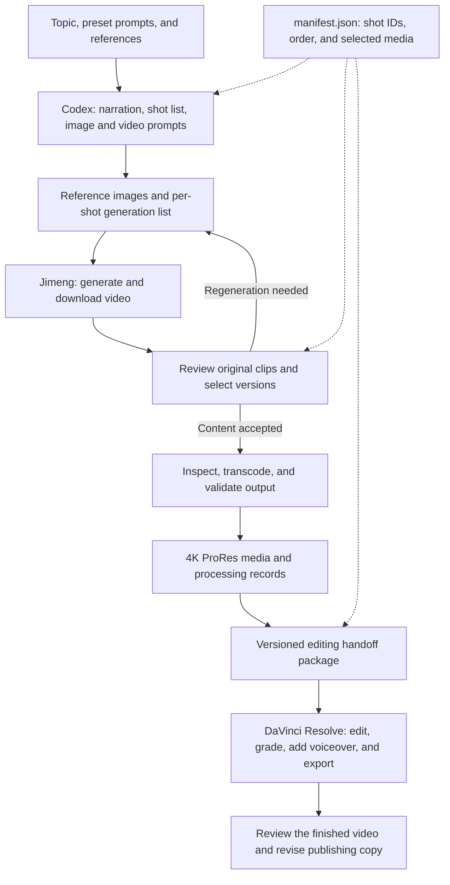
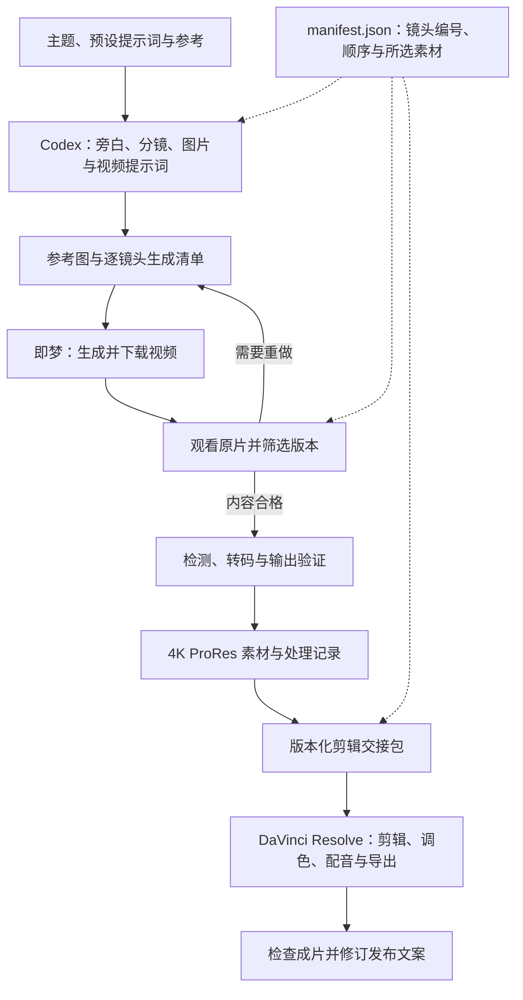

# Jimeng → DaVinci Resolve · 即梦 → 达芬奇

**Resumable Production Skill · 可续接制作 Skill**

# Developed by Hainan Yuandou Technology Co. Ltd.

**由 Hainan Yuandou Technology Co. Ltd. 开发**

[English](#english) · [简体中文](#chinese)

---

<a id="english"></a>

## English documentation

**Use Codex to organize content and shots, Jimeng to generate video, local scripts to prepare editing media, and DaVinci Resolve to complete post-production.**

`jimeng-resolve-workflow` is a video production skill for Codex. It includes workflow instructions, creative references, and two Python command-line tools. It connects the topic, narration, prompts, images, video versions, processing records, and editing order so production can proceed in stages and resume from an existing project after an interruption.

The project focuses on organizing media, recording progress, and providing reliable handoffs across tools. Project initialization, media inspection, 4K ProRes transcoding, and versioned handoff packages are implemented. Content creation relies on Codex's capabilities; Jimeng generation and DaVinci Resolve editing rely on the corresponding external tools and actual operations.

> The current implementation does not include a Jimeng API client, an automated generation queue, an AI super-resolution model, a Resolve project writer, or a YouTube uploader. The full pipeline from generation to a finished video still requires acceptance testing with a real project.

### Project background

The project began with a video production flowchart on **October 11, 2026**, and was implemented as a reusable Codex Skill.

Common difficulties in video projects that span multiple tools include:

- Scripts, images, and videos are stored in different places, making it difficult to identify the prompt behind a particular clip.
- Multiple versions of the same shot are generated, making it easy to select the wrong media for later processing.
- Switching chats or pausing work requires explaining the topic, shot order, and current progress again.
- A video exported at 4K and 30fps may still have distorted subjects, incorrect composition, or motion problems.
- Once the original clips have been processed, an editor may still lack an editing order, narration, and an explanation of missing media.

This project reduces those handoff costs through stable shot IDs, an editable `manifest.json`, processing that preserves the original clips, and a separate directory for each handoff.

### Use cases

- Producing AI short films shot by shot from a topic, script, or reference images.
- Preparing media for landscape YouTube videos or portrait short videos.
- Converting clips already downloaded from Jimeng into a consistent format suitable for post-production.
- Working on the same project across multiple sessions and regenerating only missing or unsuitable shots.
- Handing content plans and processed media to a DaVinci Resolve editor.

You can run only one stage of the workflow. For example, you can organize the shot list, inspect downloaded media, or generate a new editing handoff package.

### Workflow



#### 1. Content planning and image preparation

Codex develops continuous narration from the topic and references, then breaks the narrative into shots. Each shot records:

- Image prompt: the subject, setting, lighting, shot size, and composition of a specific moment.
- Video prompt: the action, camera movement, environmental changes, and start and end states based on the reference image.
- Narration and planned duration: a basis for later voiceover and editing.
- Actual media paths: an image is recorded as available only after it has been generated.

Selected references maintain continuity in characters, clothing, settings, and visual style. The skill also calls for `brief/youtube-copy.txt`, containing title candidates, a description, tags, and thumbnail suggestions. Final chapter timestamps must come from the actual editing timeline.

Codex creates these outputs by following the skill instructions. The two Python scripts do not generate copy or images themselves.

#### 2. Jimeng generation and original-clip archiving

Provide a reference image, video prompt, and desired duration for each shot ID. Users can generate clips on the Jimeng website, or Codex can assist when the necessary tools and authorization are available.

Save downloaded originals in `raw/` and write their actual paths back to `manifest.json`. Record task submission, prompt completion, file download, and visual review as separate states.

The first review primarily checks subjects, actions, camera movement, continuity, and distortion. Return unsuitable clips to the generation stage.

#### 3. Local media inspection and conversion

`prepare_media.py` uses FFprobe to read media information, then FFmpeg to convert selected clips into editing media.

The defaults are landscape `3840×2160`, exact `30fps`, and MOV / ProRes 422. Portrait output is `2160×3840`; ProRes 422 HQ is also available.

The script preserves the original input and produces both a video and a JSON record. The record includes input properties, processing methods, the command, output properties, and technical validation results.

#### 4. Generate a DaVinci Resolve handoff package

`project.py handoff` generates an editing order table, narration text, media list, and import instructions in the array order of `manifest.shots`.

Each run creates a separate `resolve/handoff-NNN/` directory. Existing packages remain available for comparing versions and retaining editing plans already delivered.

#### 5. DaVinci Resolve post-production and final review

Use the actual media and voiceover in DaVinci Resolve to complete editing, color grading, subtitles, mixing, and export. Set the project's timeline dimensions and frame rate before importing media, then adjust the pacing to the actual narration duration.

Final completion is determined by the actual exported file. Successful media conversion and successful handoff generation each indicate completion of their respective stage only.

### Implemented capabilities

| Module | Current capability | Execution method |
| --- | --- | --- |
| Project initialization | Creates seven working directories and a manifest with an empty shot list; refuses to overwrite an existing manifest | `project.py init` |
| Shot organization | Stable IDs, editable order, prompts, narration, and paths to selected versions | Manifest maintained by Codex or manually |
| Media inspection | Dimensions, duration, frame-rate tags, SAR, rotation, color tags, audio streams, and HDR indicators | `prepare_media.py inspect` |
| Frame fitting | Landscape or portrait 4K; preserve the full frame with padding, or center-crop to fill | orientation / fit parameters of `convert` |
| Frame-rate processing | Frame duplication or dropping by default; optional motion-compensated interpolation | cadence / interpolate |
| Intermediate encoding | ProRes 422 / 422 HQ, 10-bit 4:2:2; audio converted to PCM 48kHz | FFmpeg transcoding |
| Output validation | Checks parameters, duration, audio streams, frame intervals, and full decoding | Runs automatically after transcoding |
| Processing records | A JSON file named after the output MOV, containing processing methods and validation results | Generated automatically after transcoding |
| Editing handoff | Accumulates timing in shot-array order and outputs four handoff files | `project.py handoff` |
| Resuming and regenerating | Reuses the manifest and selected media; new versions use new filenames | Workflow conventions and manual/Codex operations |

### Core design

#### Connect the entire pipeline with shot IDs

IDs such as `S001` and `S002` remain stable across prompts, images, original clips, and processed clips. When regenerating a shot, change the version number while preserving the shot identity:

```text
images/S001_v01.png
raw/S001_v01.mp4
raw/S001_v02.mp4
processed/S001_v02.mov
processed/S001_v02.mov.json
```

The manifest points to the currently selected version; other candidates can remain in the directory. To change the shot order, move entries within the `shots` array without renaming all the media.

#### Store resumable state in project files

When resuming work, read the project settings, shot entries, and actual files to identify completed work and remaining tasks. The project does not need to depend entirely on the context of a particular chat.

The current implementation uses explicit records: the transcoding script does not update the manifest automatically, and there is no background synchronization, task queue, or automatic resume scheduler. After files are generated, the caller must write back the selected paths and check the content.

#### Preserve original clips and previous handoff versions

Initialization refuses to overwrite an existing manifest. Transcoding refuses to overwrite an existing MOV or its matching JSON. Each handoff uses a newly numbered directory.

Transcoding writes to a temporary file first and publishes the final output after technical checks pass. If publishing the processing record fails, it rolls back the video file newly generated by that run. Publication uses hard links within the same filesystem, so the target filesystem must support that operation.

#### Separate three levels of checks

| Check level | What it determines | Implementation |
| --- | --- | --- |
| File completeness | Whether a file is inside the project, nonempty, and has a supported extension | `project.py` |
| Technical media checks | Whether media can be decoded and whether dimensions, frame rate, duration, and audio streams meet the conversion requirements | `prepare_media.py` |
| Content and visual checks | Whether subjects are correct, actions are plausible, transitions are natural, and subtitles and audio are usable | Reviewing clips and the finished video |

`ready: true` in `handoff.json` **only means that every shot has a processed video that passes the file checks**. It does not prove that the files can be decoded, meet 4K30 specifications, have acceptable image quality, or have been imported into DaVinci Resolve. Manually setting `status: "done"` does not change that determination.

### Repository structure

```text
jimeng-resolve-workflow/
├── README.md
├── SKILL.md                         # Codex workflow entry point
├── .gitignore
├── agents/
│   └── openai.yaml                  # Skill display name, description, and default invocation prompt
├── references/
│   ├── creative.md                  # Narrative, shot planning, prompts, and publishing copy
│   └── media-and-resolve.md         # Media processing, quality assessment, and editing handoff
├── scripts/
│   ├── project.py                   # Project initialization and versioned handoff
│   └── prepare_media.py             # Media inspection, transcoding, and output validation
└── examples/
    └── manifest.example.json        # Two-shot structure example with no generated media
```

Video projects are stored separately from the skill code. An initialized project has the following structure:

```text
my-video-project/
├── manifest.json
├── brief/                          # Creative requirements, script, and publishing copy
├── images/                         # Reference images and selected images
├── raw/                            # Original downloaded clips
├── processed/                      # Editing media and processing records
├── audio/                          # Actual voiceover and music files
├── resolve/                        # Versioned handoff packages
└── export/                         # Final exported files
```

### Requirements and installation

| Dependency | Purpose |
| --- | --- |
| Python 3.9+ | Runs the two scripts, which use only the Python standard library |
| FFmpeg and FFprobe | Media inspection, conversion, and validation |
| A Codex environment that supports loading this Skill | Organizes content and advances the workflow according to the skill |
| A Jimeng account with available generation capabilities | External video generation stage |
| DaVinci Resolve | Post-production editing and final export stage |

The project's historical validation environment was macOS. This repository does not provide compatibility test conclusions for Windows, Linux, or different filesystems.

The FFmpeg build must provide the `prores_ks` encoder and the relevant filters. Optical-flow interpolation also requires `minterpolate`. The repository does not bundle FFmpeg, DaVinci Resolve, generation models, or third-party account credentials.

After downloading or cloning the repository, check these commands from its root directory:

```bash
python3 --version
ffmpeg -version
ffprobe -version
python3 scripts/project.py --help
python3 scripts/prepare_media.py --help
```

In environments that use `~/.codex/skills/` as the skill directory, place the complete repository folder at `~/.codex/skills/jimeng-resolve-workflow/`. If a skill with the same name already exists, inspect the existing version first and preserve any local changes you need. After reloading skills, invoke it with:

```text
$jimeng-resolve-workflow
```

The actual discovery location depends on the current Codex environment. Even without installing it as a Skill, you can run the two Python tools independently from the repository directory.

### Quick start: a two-shot example

This example plans a 10-second short film set in a bookstore on a rainy night. The example manifest contains only a plan: image and video paths are empty, and no generated outputs are included.

#### 1. Initialize the project

Run from the repository root:

```bash
python3 scripts/project.py init "./projects/rainy-bookstore" \
  --title "雨夜书店" \
  --orientation landscape \
  --duration 10 \
  --language zh
```

For this newly created demonstration project, copy the example as the shot plan:

```bash
cp examples/manifest.example.json projects/rainy-bookstore/manifest.json
```

The example uses two 5-second shots: first establish the bookstore exterior on a rainy night, then move inside. For actual production, adjust the timing to the real voiceover and generation results.

#### 2. Start creating in Codex

```text
Use $jimeng-resolve-workflow.

Continue the project at ./projects/rainy-bookstore.
The topic is a bookstore on a rainy night, in landscape format,
with Chinese narration and a target duration of approximately 10 seconds.
Read the manifest and retain the two shot IDs and visual settings.
Create reference images and a copyable Jimeng video generation list.
Maintain continuity in the same bookstore's doors, windows, lighting, and colors.
Write media paths only after the files have actually been generated,
and keep unfinished stages marked as unfinished.
```

#### 3. Generate and record original clips

Use the reference images and corresponding video prompts in Jimeng to generate clips, then review them and select versions. Place the downloaded files at:

```text
projects/rainy-bookstore/raw/S001_v01.mp4
projects/rainy-bookstore/raw/S002_v01.mp4
```

Set each shot's `image` and `raw_video` to actual paths relative to the project, such as `raw/S001_v01.mp4`. If only prompts exist, leave the image and video fields empty.

#### 4. Inspect and process a representative clip

```bash
python3 scripts/prepare_media.py inspect \
  "./projects/rainy-bookstore/raw/S001_v01.mp4"

python3 scripts/prepare_media.py convert \
  "./projects/rainy-bookstore/raw/S001_v01.mp4" \
  "./projects/rainy-bookstore/processed/S001_v01.mov" \
  --orientation landscape \
  --fps 30 \
  --frame-policy cadence \
  --fit contain \
  --profile 422
```

On success, the output consists of `S001_v01.mov` and `S001_v01.mov.json`. Watch the output and check composition, action, audio, and differences from the original before processing the second shot.

Set the processed shot's `processed_video` to `processed/S001_v01.mov`, and do the same for the second shot. To record processing methods, you can add `enhancement_method` and `quality_notes`; these extension fields are maintained by the caller.

#### 5. Generate the handoff package

```bash
python3 scripts/project.py handoff "./projects/rainy-bookstore"
```

Output structure:

```text
resolve/handoff-001/
├── edit-plan.csv
├── narration.txt
├── handoff.json
└── import-notes.txt
```

You can also run this command before clips have been downloaded or processed to see what is missing. A successfully generated report returns exit code `0`, even when `ready` is `false`. Read the JSON content to determine whether the media is complete.

#### 6. Complete post-production in DaVinci Resolve

Read the import instructions and set the timeline to landscape `3840×2160` at exact `30fps`. Import the reviewed processed clips and build the timeline according to the editing table. Then adjust shot lengths to the actual voiceover, complete post-production, and export.

The CSV is an editing plan. The repository does not currently create a `.drp` project automatically or place media on a Resolve timeline.

### Manifest reference

See [examples/manifest.example.json](examples/manifest.example.json) for a complete example.

| Field | Meaning and convention |
| --- | --- |
| `version` | The current format version is the integer `1` |
| `title` | Project name |
| `orientation` | `landscape` or `portrait` |
| `target` | Landscape 3840×2160 or portrait 2160×3840; the handoff tool requires 30fps |
| `duration_seconds` | Planned project duration; must be a finite positive number |
| `language` | Language of narration and copy |
| `master_prompt` | Overall creative requirements for the project |
| `shots` | Shot array; array order determines editing order |
| `shot_id` | A stable ID in the form `S001`; duplicates are not allowed |
| `shots[].duration_seconds` | Planned shot duration; must be a finite positive number |
| `voiceover` | Narration text for the shot |
| `image_prompt` / `video_prompt` | Static-image and motion descriptions |
| `image` / `raw_video` / `processed_video` | Currently selected media; leave empty until generated |
| `status` | A descriptive stage record maintained by a person or Codex, not a basis for automatic acceptance |

If the sum of planned shot durations differs from the project duration, the handoff records the difference and still generates the editing order from the shot durations. It does not stretch video or correct narration automatically.

Paths relative to the project are recommended. The handoff script also accepts absolute paths that remain inside the project after resolution, but rejects media paths and symbolic links that escape the project directory. It does not fully validate the semantics of images, prompts, or extension status fields.

### Commands and parameters

#### `project.py`

```bash
python3 scripts/project.py init PROJECT --title TITLE \
  [--orientation landscape|portrait] [--duration SECONDS] [--language zh]

python3 scripts/project.py handoff PROJECT
```

`init` defaults to landscape, 60 seconds, and Chinese, and creates an empty `shots` array. A project with no shots cannot generate a handoff package.

`handoff` prefers each shot's `processed_video`. If the processed clip is unavailable, it falls back to the original and marks it `needs_processing`. If neither exists, it marks the shot `missing_video`. Nonempty files may have the extensions `.mp4`, `.mov`, `.mxf`, `.mkv`, `.avi`, `.m4v`, or `.webm`. This extension check does not validate the file contents.

#### `prepare_media.py`

```bash
python3 scripts/prepare_media.py inspect INPUT

python3 scripts/prepare_media.py convert INPUT OUTPUT.mov \
  [--orientation landscape|portrait] \
  [--fps 30] \
  [--frame-policy cadence|interpolate] \
  [--fit contain|cover] \
  [--profile 422|hq]
```

| Parameter | Default | Behavior |
| --- | --- | --- |
| `--orientation` | `landscape` | Selects a landscape or portrait 4K canvas |
| `--fps` | `30` | The conversion command accepts frame rates greater than 0 and up to 120; this workflow's handoff uses a fixed 30 |
| `--frame-policy` | `cadence` | Duplicates/drops frames; `interpolate` uses motion-compensated interpolation |
| `--fit` | `contain` | Preserves the full frame with black padding; `cover` center-crops to fill |
| `--profile` | `422` | ProRes 422; `hq` selects ProRes 422 HQ |
| `--ffmpeg` / `--ffprobe` | Commands of the same name on PATH | Allows explicit tool paths |

The output directory must already exist, and the output extension must be `.mov`. If a video or `.mov.json` with the same name already exists, use a new filename such as `v02`.

### Media-processing technical details

- **Video-stream selection:** Processes the first non-cover-art video stream. Other video streams are excluded from the output, and the relevant indices are saved in the processing record.
- **Display aspect ratio:** Handles rotation metadata and non-square pixels, normalizes the pixel aspect ratio to 1:1, then fits the target canvas.
- **Scaling:** Uses Lanczos resampling. 4K output describes the canvas dimensions; it does not mean native 4K detail has been recovered. See the [FFmpeg Scaler documentation](https://ffmpeg.org/ffmpeg-scaler.html).
- **Frame rate:** Uses `fps` to duplicate or drop frames by default. Optional `minterpolate` provides motion-compensated interpolation, with tail padding and trimming back to the source duration to reduce filter truncation. Optical-flow output still requires visual review. See the [fps documentation](https://ffmpeg.org/ffmpeg-filters.html#fps) and [minterpolate documentation](https://ffmpeg.org/ffmpeg-filters.html#minterpolate).
- **Color:** Preserves existing color-primaries, transfer-function, and matrix tags without guessing unknown tags. Input explicitly tagged as full-range `pc` is mapped to ProRes video range `tv`. Conversion is refused when PQ, HLG, or related HDR metadata is detected; such media requires an explicit color-management workflow.
- **Encoding:** Outputs `prores_ks` and `yuv422p10le`, producing 10-bit 4:2:2 ProRes intermediate media. Converting an 8-bit source to 10-bit encoding does not add information to the source. See the [FFmpeg ProRes documentation](https://ffmpeg.org/ffmpeg-codecs.html#ProRes).
- **Audio streams:** Preserves all input audio streams, converts them to PCM 16-bit / 48kHz, and checks the stream and channel counts.
- **Validation:** Checks output dimensions, codec, pixel format, frame-rate tags, duration changes, and known color tags; scans output packet timestamps to verify constant frame intervals; and finally decodes the complete output video and audio.

The input's `avg_frame_rate` and `r_frame_rate` are stream metadata only. `inspect` does not scan all input frame timestamps, so it marks whether the input is VFR as `not_determined`. After conversion, the output's actual packet intervals are checked.

Visual review is still required after technical checks pass, particularly for fast motion, occlusion, faces, cuts, audio/video synchronization, and continuity between shots.

### Handoff package and processing records

| File | Contents |
| --- | --- |
| `edit-plan.csv` | Shot IDs, planned in/out points in seconds, local media paths, narration, and status notes; UTF-8 BOM helps spreadsheet applications read it |
| `narration.txt` | Numbered narration in editing order |
| `handoff.json` | Target specifications, total planned duration, preset duration, file-completeness results, unready shots, and output paths |
| `import-notes.txt` | DaVinci Resolve import steps and notes on unfinished work |
| `OUTPUT.mov.json` | Source-media information, processing parameters, the FFmpeg command, output information, and technical validation results |

The handoff package includes absolute media paths from the current machine, and processing records also contain local input and output locations. After moving a project to another computer, correct the media locations in the manifest and regenerate the handoff. Publishing the source code does not require including private video projects or their processing records.

### Resuming a project

```text
Use $jimeng-resolve-workflow to resume ./projects/rainy-bookstore.

Read the manifest and preserve the selected reference images and shot order.
Check the actual downloaded clips in raw and the existing conversion outputs in processed.
Process only missing or unsuitable shots; complete and review one representative clip first.
Output landscape 4K30 ProRes and record the processing methods actually used.
Update the selected media paths, then generate a new DaVinci Resolve handoff package.
```

To regenerate a single shot, specify it explicitly:

```text
Regenerate S002 only. Preserve S001 and the currently selected versions.
Use v02 for the new media, and update the selected path in the manifest only after review passes.
Preserve the previous handoff directory and generate the next version of the handoff package.
```

### Development and validation status

| Date | Record |
| --- | --- |
| 2026-10-11 | Chose a reusable Codex Skill based on the workflow diagram, completed the skill instructions, two scripts, and reference documents, and installed it in the local skill directory |
| 2026-10-11 | Development records reported landscape and portrait 4K30 ProRes short-clip conversion, audio preservation, frame inspection of padding, and tonal-range checks; a planning trial for a “45-second rainy-night bookstore” explicitly left images and videos still to be generated |
| 2026-10-18 / 19 | Included in the local knowledge base and subsequent project production guide; teaching cards in the knowledge base are not evidence of successful execution |
| 2026-11-16 | Prepared GitHub documentation against the existing source code and added a manifest example without media; checked the CLI, example initialization, and handoff behavior with missing media |

The historical development records explicitly retained this boundary: **end-to-end acceptance testing of a real production project, from Jimeng generation through final DaVinci Resolve export, has not been completed.** This documentation work did not rerun external video generation or produce a finished video.

The repository currently has no continuous integration or complete automated test suite, and historical test media is not distributed with it. Implemented capabilities can be checked against the code. Historical short-clip test reports and actual results in future users' environments should be assessed separately.

### Known limitations and possible extensions

#### Current limitations

- Jimeng website operations depend on currently available browser tools and a logged-in session; the repository does not include a fixed browser-automation script.
- API integration is an optional future path. Model selection, generation submission, polling, and downloading are not built in.
- No AI super-resolution engine is included. Ordinary scaling, frame-rate normalization, and optical-flow interpolation each serve a distinct purpose.
- HDR conversion is outside the scope of the current processing script; media without color tags still requires human judgment.
- The processing script does not choose versions for users or write back to the manifest automatically.
- The handoff script does not check whether source clips are long enough for their planned durations, nor does it handle transitions, overlapping edits, or an audio timeline.
- Narration text is not a voice file. Voiceover, music, subtitles, and finished-video acceptance must actually be completed.
- Only local media files can enter the current handoff workflow; cloud project synchronization is not implemented.

#### Possible development directions

The following are proposed extensions and have not been implemented:

- Add an explicit manifest schema, field validation, and tools for writing processing results back to the manifest.
- Add a generation queue with retries, failure recovery, and explicit cost limits.
- Integrate a selected official Jimeng API while retaining the mapping from tasks to shots.
- Integrate an available super-resolution engine and retain before/after comparisons and human quality-review results.
- Generate an importable timeline format or use the Resolve scripting interface to build a rough cut.
- Use actual voiceover durations to help adjust the shot plan, and add subtitle and audio-track management.
- Add synthetic test media, automated regression checks, and cross-platform validation.
- Use a complete real project to validate consistency across generation, selection, transcoding, editing, export, and publishing copy.

### Contributing and publication notes

When reporting a problem, provide the command used, Python / FFmpeg versions, reproducible media properties, and the error message. For transcoding issues, describe orientation, frame-rate policy, fitting mode, color tags, and audio-stream details. Check processing records for local paths before sharing them.

Changes should preserve the relationship between shot IDs and versions and clearly state which stage was validated. When adding support for an external platform, distinguish tool capabilities, user-account requirements, and stages that remain unverified.

The current release package does not include a `LICENSE`, and no open-source license has been selected. The repository maintainer may add a license file according to their publishing intentions.

[简体中文 ↓](#chinese)

---

<a id="chinese"></a>

## 中文说明

**用 Codex 组织内容与镜头，用即梦生成视频，用本地脚本准备剪辑素材，再交给 DaVinci Resolve 完成后期。**

`jimeng-resolve-workflow` 是一套面向 Codex 的视频制作技能，包含工作流说明、创作参考和两个 Python 命令行工具。它把主题、旁白、提示词、图片、视频版本、处理记录和剪辑顺序连接起来，让一次制作可以分阶段推进，也可以在中断后从现有项目继续。

项目重点是跨工具制作中的素材组织、状态记录和可靠交接。当前已实现项目初始化、素材检测、4K ProRes 转码和版本化交接包；内容创作依赖 Codex 的能力，即梦生成与达芬奇剪辑依赖相应外部工具及实际操作。

> 当前实现未内置即梦 API 客户端、自动生成队列、AI 超分模型、Resolve 工程写入器或 YouTube 上传器。完整真实项目的生成到成片链路，仍需要另行验收。

### 项目背景

项目于 **2026 年 10 月 11 日**从一张视频制作流程图出发，最终选择以可重复调用的 Codex Skill 实现。

在由多个工具共同完成的视频项目中，常见困难包括：

- 脚本、图片和视频分别保存在不同位置，难以确认某个片段对应哪条提示词。
- 同一个镜头生成了多个版本，后续处理时容易选错素材。
- 中途换聊天或暂停后，需要重新解释主题、镜头顺序和当前进度。
- 视频虽然输出成 4K、30fps，仍可能存在主体形变、构图错误或运动问题。
- 原始片段处理完成后，缺少可交给剪辑者使用的顺序、旁白和缺失素材说明。

本项目通过稳定的镜头编号、可编辑的 `manifest.json`、保留原片的处理方式，以及每次独立生成的交接目录，降低这些衔接成本。

### 适用场景

- 根据主题、脚本或参考图，逐镜头制作 AI 短片。
- 制作 YouTube 横屏视频或竖屏短视频素材。
- 已有即梦下载片段，需要统一到适合后期剪辑的格式。
- 同一个项目分多次制作，只重做缺失或不合格的镜头。
- 将内容策划和素材处理成果交给达芬奇剪辑人员。

同一条流程可以只执行其中一个阶段。例如，仅整理分镜、仅检查下载素材，或者仅生成新的剪辑交接包。

### 工作流



#### 1. 内容策划与图像准备

Codex 根据主题和参考组织连续的旁白，再将叙事拆成镜头。每个镜头分别记录：

- 图片提示词：描述一个明确瞬间的主体、场景、光线、景别和构图。
- 视频提示词：描述基于参考图发生的动作、运镜、环境变化和起止状态。
- 旁白与计划时长：为后续配音和剪辑提供依据。
- 实际素材路径：已生成的图片才记录为可用图片。

人物、服装、环境和视觉风格通过已选参考延续。技能还约定生成 `brief/youtube-copy.txt`，包括标题候选、简介、标签和封面建议；最终章节时间以真实剪辑时间线为准。

上述创作产物由 Codex 按技能说明制作，两个 Python 脚本不会自行生成文案或图片。

#### 2. 即梦生成与原片归档

按镜头编号提供参考图、视频提示词和期望时长。用户可在即梦网页完成生成，也可在具备相应工具与授权时由 Codex 协助操作。

下载的原片保存到 `raw/`，并将实际路径写回 `manifest.json`。任务已提交、提示词已写好、文件已下载和画面已通过检查，应分别记录。

第一轮观看主要检查主体、动作、运镜、连续性和形变。不合格片段回到生成阶段重做。

#### 3. 本地素材检测与转换

`prepare_media.py` 使用 FFprobe 读取媒体信息，再用 FFmpeg 将选定片段转换成剪辑素材。

默认设置为横屏 `3840×2160`、精确 `30fps`、MOV / ProRes 422。竖屏输出为 `2160×3840`，也可选择 ProRes 422 HQ。

脚本保留原始输入，处理完成后同时输出视频和 JSON 记录，记录输入属性、处理方法、命令、输出属性与技术验证结果。

#### 4. 生成达芬奇交接包

`project.py handoff` 按 `manifest.shots` 的数组顺序生成剪辑顺序表、旁白文本、素材清单及导入说明。

每次生成独立的 `resolve/handoff-NNN/`。已有交接包保留，方便比较前后版本，也方便保留已经交付的剪辑计划。

#### 5. 达芬奇后期与最终检查

在达芬奇中根据实际素材和配音完成剪辑、调色、字幕、混音及导出。导入前设置项目对应的时间线尺寸和帧率，之后用真实旁白时长调整节奏。

最终完成状态以实际导出的文件为依据。素材转换成功和交接包生成成功，各自只代表其阶段完成。

### 已实现的能力

| 模块 | 当前能力 | 执行方式 |
| --- | --- | --- |
| 项目初始化 | 创建七个工作目录和空镜头 manifest；拒绝覆盖已有 manifest | `project.py init` |
| 镜头组织 | 稳定编号、可编辑顺序、提示词、旁白及所选版本路径 | Codex 或人工维护 manifest |
| 素材检查 | 尺寸、时长、帧率标签、SAR、旋转、色彩标签、音轨及 HDR 提示 | `prepare_media.py inspect` |
| 画面适配 | 横竖屏 4K；完整保留并补边，或居中裁切填满 | `convert` 的 orientation / fit 参数 |
| 帧率处理 | 默认复制或丢弃帧；可选运动补偿插帧 | cadence / interpolate |
| 中间编码 | ProRes 422 / 422 HQ、10-bit 4:2:2；音轨转 PCM 48kHz | FFmpeg 转码 |
| 输出验证 | 参数、时长、音轨、帧时间间隔与全量解码检查 | 转码后自动执行 |
| 处理记录 | 与输出 MOV 同名的 JSON，保存处理方法与验证结果 | 转码后自动生成 |
| 剪辑交接 | 按镜头数组顺序累计时间，输出四份交接文件 | `project.py handoff` |
| 续做与重做 | 复用 manifest 和已选素材；新版本使用新文件名 | 工作流约定与人工/Codex 操作 |

### 核心设计

#### 用镜头编号连接整条链路

`S001`、`S002` 等编号在提示词、图片、原片和处理片之间保持稳定。重做镜头时改变版本号，保留镜头身份：

```text
images/S001_v01.png
raw/S001_v01.mp4
raw/S001_v02.mp4
processed/S001_v02.mov
processed/S001_v02.mov.json
```

manifest 指向当前选中的版本；其他候选可以继续留在目录里。调整镜头顺序时移动 `shots` 数组中的条目，无需重命名全部素材。

#### 将可续做状态保存在项目文件中

续做时读取项目设定、镜头条目和实际文件，确定已经完成的工作及剩余事项。项目不需要完全依赖某次聊天中的上下文。

当前实现采用显式记录：转码脚本不会自动更新 manifest，也没有后台同步、任务队列或自动断点调度。调用者需要在文件生成后写回选定路径，并核对内容。

#### 保留原片和旧交接版本

初始化拒绝覆盖已有 manifest；转码拒绝覆盖已有 MOV 或同名 JSON；交接包采用新的编号目录。

转码先写入临时文件，完成技术检查后再发布正式输出。若发布处理记录失败，会回滚本次新生成的视频文件。发布使用同文件系统硬链接，因此目标文件系统需要支持该操作。

#### 把三层检查分开

| 检查层次 | 能判断的内容 | 实现位置 |
| --- | --- | --- |
| 文件齐备 | 文件是否位于项目内、是否为支持扩展名的非空文件 | `project.py` |
| 媒体技术检查 | 是否可解码，尺寸、帧率、时长和音轨是否符合转换要求 | `prepare_media.py` |
| 内容与视觉检查 | 主体是否正确、动作是否合理、衔接是否自然、字幕与声音是否可用 | 观看素材和成片 |

`handoff.json` 中的 `ready: true` **仅表示每个镜头都有通过文件检查的 processed 视频**。它没有证明文件可解码、达到 4K30、画质合格或已经导入达芬奇。手工填写 `status: "done"` 也不会改变这个判断。

### 仓库结构

```text
jimeng-resolve-workflow/
├── README.md
├── SKILL.md                         # Codex 工作流入口
├── .gitignore
├── agents/
│   └── openai.yaml                  # 技能显示名称、简介与默认调用提示
├── references/
│   ├── creative.md                  # 叙事、分镜、提示词与发布文案
│   └── media-and-resolve.md         # 媒体处理、画质判断与剪辑交接
├── scripts/
│   ├── project.py                   # 项目初始化和版本化交接
│   └── prepare_media.py             # 媒体检测、转码和输出验证
└── examples/
    └── manifest.example.json        # 两镜头结构示例，无已生成素材
```

视频项目与技能代码分开保存。初始化后的项目目录如下：

```text
my-video-project/
├── manifest.json
├── brief/                          # 创作要求、脚本与发布文案
├── images/                         # 参考图和已选图片
├── raw/                            # 原始下载片段
├── processed/                      # 剪辑素材及处理记录
├── audio/                          # 实际配音与音乐文件
├── resolve/                        # 版本化交接包
└── export/                         # 最终导出文件
```

### 环境要求与安装

| 依赖 | 用途 |
| --- | --- |
| Python 3.9+ | 运行两个脚本，仅使用 Python 标准库 |
| FFmpeg 与 FFprobe | 素材检测、转换和验证 |
| 支持加载此 Skill 的 Codex 环境 | 按技能组织内容和推进工作流 |
| 即梦账户与可用生成能力 | 外部视频生成阶段 |
| DaVinci Resolve | 后期剪辑和最终导出阶段 |

本项目历史验证环境为 macOS。Windows、Linux 和不同文件系统未在本仓库中提供兼容性测试结论。

FFmpeg 构建需要提供 `prores_ks` 编码器及相关滤镜；光流插帧模式还需要 `minterpolate`。仓库不捆绑 FFmpeg、达芬奇、生成模型或第三方账户凭证。

下载或克隆仓库后，在仓库根目录检查命令：

```bash
python3 --version
ffmpeg -version
ffprobe -version
python3 scripts/project.py --help
python3 scripts/prepare_media.py --help
```

在使用 `~/.codex/skills/` 作为技能目录的环境中，可将本仓库完整文件夹放到 `~/.codex/skills/jimeng-resolve-workflow/`。已有同名技能时先检查已有版本，保留需要的本地修改。重新加载技能后，用以下名称调用：

```text
$jimeng-resolve-workflow
```

实际识别位置以当前 Codex 环境为准。未安装为 Skill 时，两个 Python 工具仍可从仓库目录独立运行。

### 快速开始：两镜头示例

以下示例规划一段 10 秒的雨夜书店短片。示例 manifest 只包含计划；图片和视频路径为空，不包含生成成果。

#### 1. 初始化项目

在仓库根目录执行：

```bash
python3 scripts/project.py init "./projects/rainy-bookstore" \
  --title "雨夜书店" \
  --orientation landscape \
  --duration 10 \
  --language zh
```

对这个刚创建的演示项目，复制示例作为镜头计划：

```bash
cp examples/manifest.example.json projects/rainy-bookstore/manifest.json
```

示例安排两个 5 秒镜头：先建立雨夜书店外景，再进入书店内部。真实制作时，应根据实际配音和生成结果调整时间。

#### 2. 在 Codex 中开始创作

```text
使用 $jimeng-resolve-workflow。

继续项目目录 ./projects/rainy-bookstore。
主题是雨夜书店，横屏、中文、目标约10秒。
请读取 manifest，沿用两个镜头的编号与视觉设定，
完成参考图和可复制的即梦视频生成清单。
保持同一间书店的门窗、灯光和色彩连续。
实际生成的素材再写入对应路径，保留未完成阶段。
```

#### 3. 生成并记录原片

在即梦使用参考图与对应的视频提示词生成片段，观看后选择版本。将下载文件放入：

```text
projects/rainy-bookstore/raw/S001_v01.mp4
projects/rainy-bookstore/raw/S002_v01.mp4
```

把各镜头的 `image` 和 `raw_video` 改为真实的项目内相对路径，例如 `raw/S001_v01.mp4`。只有提示词时，图片和视频字段继续留空。

#### 4. 检查并处理代表片段

```bash
python3 scripts/prepare_media.py inspect \
  "./projects/rainy-bookstore/raw/S001_v01.mp4"

python3 scripts/prepare_media.py convert \
  "./projects/rainy-bookstore/raw/S001_v01.mp4" \
  "./projects/rainy-bookstore/processed/S001_v01.mov" \
  --orientation landscape \
  --fps 30 \
  --frame-policy cadence \
  --fit contain \
  --profile 422
```

成功后得到 `S001_v01.mov` 和 `S001_v01.mov.json`。观看输出，核对构图、动作、音轨和原片差异，再处理第二个镜头。

将已处理镜头的 `processed_video` 填为 `processed/S001_v01.mov`，第二个镜头同理。若需要记录处理方式，可以增加 `enhancement_method` 和 `quality_notes` 字段；这些扩展字段由调用者维护。

#### 5. 生成交接包

```bash
python3 scripts/project.py handoff "./projects/rainy-bookstore"
```

输出结构：

```text
resolve/handoff-001/
├── edit-plan.csv
├── narration.txt
├── handoff.json
└── import-notes.txt
```

在没有下载或处理片段时，也可以使用这条命令查看缺失项。命令成功生成报告时返回退出码 `0`，即使 `ready` 为 `false`；需要判断素材是否齐备时应读取 JSON 内容。

#### 6. 在达芬奇完成后期

阅读导入说明，将时间线设置为横屏 `3840×2160`、精确 `30fps`。导入已检查的处理片，按剪辑表搭建时间线，再以实际配音调整镜头长度，完成后期和导出。

CSV 是剪辑计划；仓库当前不会自动创建 `.drp` 工程或将素材放入 Resolve 时间线。

### Manifest 说明

完整示例见 [examples/manifest.example.json](examples/manifest.example.json)。

| 字段 | 含义与约定 |
| --- | --- |
| `version` | 当前格式版本为整数 `1` |
| `title` | 项目名称 |
| `orientation` | `landscape` 或 `portrait` |
| `target` | 横屏 3840×2160 或竖屏 2160×3840，交接工具固定要求 30fps |
| `duration_seconds` | 项目计划时长，须为有限正数 |
| `language` | 旁白与文案语言 |
| `master_prompt` | 项目总体创作要求 |
| `shots` | 镜头数组，数组顺序决定剪辑顺序 |
| `shot_id` | `S001` 形式的稳定编号，不能重复 |
| `shots[].duration_seconds` | 镜头计划时长，须为有限正数 |
| `voiceover` | 该镜头的旁白文本 |
| `image_prompt` / `video_prompt` | 静态画面和运动描述 |
| `image` / `raw_video` / `processed_video` | 当前选定素材；尚未生成时留空 |
| `status` | 人或 Codex 维护的说明性阶段记录，不是自动验收依据 |

镜头计划时长总和与项目时长不一致时，交接包会记录差异，仍按镜头时长生成顺序表。它不会拉伸视频或自动修正旁白。

建议使用项目内相对路径。交接脚本也接受解析后仍位于项目内的绝对路径，但拒绝越出项目目录的素材路径和符号链接。图片、提示词及扩展状态字段不会被交接脚本做完整语义校验。

### 命令与参数

#### `project.py`

```bash
python3 scripts/project.py init PROJECT --title TITLE \
  [--orientation landscape|portrait] [--duration SECONDS] [--language zh]

python3 scripts/project.py handoff PROJECT
```

`init` 默认横屏、60 秒、中文，创建空的 `shots`。空镜头项目不能生成交接包。

`handoff` 优先选择每个镜头的 `processed_video`；处理片不存在时回退到原片并标记 `needs_processing`；两者都不存在时标记 `missing_video`。非空文件的扩展名可为 `.mp4`、`.mov`、`.mxf`、`.mkv`、`.avi`、`.m4v` 或 `.webm`。这项扩展名检查不代表文件内容已验证。

#### `prepare_media.py`

```bash
python3 scripts/prepare_media.py inspect INPUT

python3 scripts/prepare_media.py convert INPUT OUTPUT.mov \
  [--orientation landscape|portrait] \
  [--fps 30] \
  [--frame-policy cadence|interpolate] \
  [--fit contain|cover] \
  [--profile 422|hq]
```

| 参数 | 默认值 | 行为 |
| --- | --- | --- |
| `--orientation` | `landscape` | 选择横屏或竖屏 4K 画布 |
| `--fps` | `30` | 转码命令允许大于 0、至多 120 的帧率；本工作流交接固定使用 30 |
| `--frame-policy` | `cadence` | 复制/丢弃帧；`interpolate` 使用运动补偿插帧 |
| `--fit` | `contain` | 保留完整画面并补黑边；`cover` 居中裁切填满 |
| `--profile` | `422` | ProRes 422；`hq` 为 ProRes 422 HQ |
| `--ffmpeg` / `--ffprobe` | PATH 中同名命令 | 可指定工具路径 |

输出目录必须已经存在，输出扩展名必须为 `.mov`。同名视频或 `.mov.json` 已存在时，应改用 `v02` 等新文件名。

### 媒体处理的技术细节

- **视频流选择：**处理第一个非封面视频流，其他视频流不进入输出，相关索引记入处理记录。
- **显示比例：**处理旋转信息与非方形像素，将像素宽高比规范为 1:1，再适配目标画布。
- **缩放：**采用 Lanczos 重采样。4K 输出表示画布尺寸，不表示恢复原生 4K 细节。参见 [FFmpeg Scaler 文档](https://ffmpeg.org/ffmpeg-scaler.html)。
- **帧率：**默认用 `fps` 复制或丢弃帧。可选 `minterpolate` 运动补偿插帧，并通过补齐尾帧及裁回源时长减少滤镜截断；光流仍需观看检查。参见 [fps 文档](https://ffmpeg.org/ffmpeg-filters.html#fps) 与 [minterpolate 文档](https://ffmpeg.org/ffmpeg-filters.html#minterpolate)。
- **色彩：**保留已有色域、传递函数和矩阵标签；未知标签不猜测。明确标记为全范围 `pc` 的输入会映射到 ProRes 视频范围 `tv`。检测到 PQ、HLG 或相关 HDR 元数据时拒绝转换，交由明确的色彩管理流程处理。
- **编码：**输出 `prores_ks`、`yuv422p10le`，对应 10-bit 4:2:2 ProRes 中间素材。8-bit 源素材转为 10-bit 编码不会增加源片原有信息。参见 [FFmpeg ProRes 文档](https://ffmpeg.org/ffmpeg-codecs.html#ProRes)。
- **音轨：**保留全部输入音轨，转为 PCM 16-bit / 48kHz，并检查音轨数量和声道数。
- **验证：**检查输出尺寸、编码、像素格式、帧率标签、时长变化和已知色彩标签；扫描输出包时间戳验证恒定帧间隔，最后全量解码输出音视频。

输入的 `avg_frame_rate` 与 `r_frame_rate` 只是流元数据。`inspect` 不扫描输入的全部帧时间戳，因此会将输入是否 VFR 标为 `not_determined`；输出转换后则会检查实际包时间间隔。

技术检查通过仍需观看，尤其要核对快速运动、遮挡、脸部、剪切点、音画同步和镜头间连续性。

### 交接包与处理记录

| 文件 | 内容 |
| --- | --- |
| `edit-plan.csv` | 镜头编号、计划入点/出点（秒）、本地素材路径、旁白与状态说明；UTF-8 BOM 便于表格软件读取 |
| `narration.txt` | 按剪辑顺序排列的带编号旁白 |
| `handoff.json` | 目标规格、计划总时长、预设时长、文件齐备结果、未就绪镜头与输出路径 |
| `import-notes.txt` | 达芬奇导入步骤及未完成事项说明 |
| `OUTPUT.mov.json` | 源媒体信息、处理参数、FFmpeg 命令、输出信息及技术验证结果 |

交接包会写入当前机器的绝对素材路径，处理记录也包含本地输入、输出位置。项目换电脑后，先修正 manifest 中的素材位置并重新生成交接包。源码发布不需要包含私人视频项目或其处理记录。

### 中途续做示例

```text
使用 $jimeng-resolve-workflow 续做 ./projects/rainy-bookstore。

读取 manifest，保留已选参考图和镜头顺序。
检查 raw 中的实际下载片段，以及 processed 中已有的转换结果。
只处理缺失或不合格的镜头；先完成一个代表片段并观看检查。
输出横屏4K30 ProRes，记录实际处理方法。
更新选定素材路径，然后生成新的达芬奇交接包。
```

单镜头重做时，可以明确指定：

```text
只重做 S002。保留 S001 和当前已选版本。
新素材使用 v02，检查通过后再更新 manifest 的选定路径。
保留旧交接目录，并生成下一版交接包。
```

### 开发与验证情况

| 时间 | 记录 |
| --- | --- |
| 2026-10-11 | 根据工作流图确定以可重复调用的 Codex Skill 实现，完成技能说明、两个脚本及参考文档，并安装到本机技能目录 |
| 2026-10-11 | 开发记录报告完成横竖屏 4K30 ProRes 短片转换、音轨保留、补边抽帧及色阶检查；试跑“45 秒雨夜书店”策划请求，明确图片和视频仍待生成 |
| 2026-10-18 / 19 | 收录到本机知识库及后续项目制作指南；知识库的教学卡不作为实际执行通过的证据 |
| 2026-11-16 | 对照现存源码整理 GitHub 文档、增加无素材的 manifest 示例；核对 CLI、示例初始化与缺失素材交接行为 |

历史开发记录明确保留了一个边界：**尚未用真实制作项目完成从即梦生成到达芬奇最终导出的整条链路验收。** 本次整理文档没有重新执行外部视频生成或成片制作。

仓库当前没有持续集成或完整自动化测试套件，也没有随仓库发布历史测试媒体。已实现能力可以从代码核对；历史短片测试报告和未来使用者环境中的实际结果应分别判断。

### 已知限制与扩展方向

#### 当前限制

- 即梦网页操作依赖当前可用的浏览器工具和已登录会话；仓库没有固定浏览器自动化脚本。
- API 接入是后续可选路径，当前没有内置模型选择、生成提交、轮询和下载实现。
- 没有随附 AI 超分引擎。普通缩放、帧率统一和光流插帧各有独立作用。
- HDR 转换不在现有处理脚本范围内；未标记色彩信息的素材仍需人工判断。
- 处理脚本不替用户选择版本，也不自动写回 manifest。
- 交接脚本不核对源片是否足够覆盖计划时长，也不处理转场、重叠剪辑或声音时间线。
- 旁白文本不等于语音文件；配音、音乐、字幕与成片验收需要实际完成。
- 只有本机素材文件可进入当前交接流程，未实现云端项目同步。

#### 可继续开发的方向

以下为扩展建议，尚未实现：

- 为 manifest 增加显式 schema、字段校验与处理结果回写工具。
- 增加带重试、失败恢复和明确费用边界的生成队列。
- 对接选定的即梦官方 API，并保留任务到镜头的映射。
- 对接可用超分引擎，保存前后对比和人工质量评审结果。
- 生成可导入的时间线格式，或通过 Resolve 脚本接口建立粗剪。
- 使用实际配音时长辅助调整镜头计划，增加字幕与音轨管理。
- 增加人工构造测试媒体、自动回归检查与多平台验证。
- 用完整真实项目验证生成、筛选、转码、剪辑、导出和发布文案的一致性。

### 协作与发布说明

反馈问题时，可提供执行命令、Python / FFmpeg 版本、可复现的媒体属性和错误信息。涉及转码异常时，应说明横竖屏、帧率策略、适配方式、色彩标签及音轨情况；分享处理记录前检查其中的本机路径。

提交修改应保留镜头编号与版本对应关系，并清楚说明验证了哪个阶段。新增外部平台支持时，分别说明工具能力、用户账户要求和尚未验证的环节。

当前发布包未附 `LICENSE`，未选择开源许可证。仓库维护者可按自己的发布意图补充许可文件。

[English ↑](#english)
