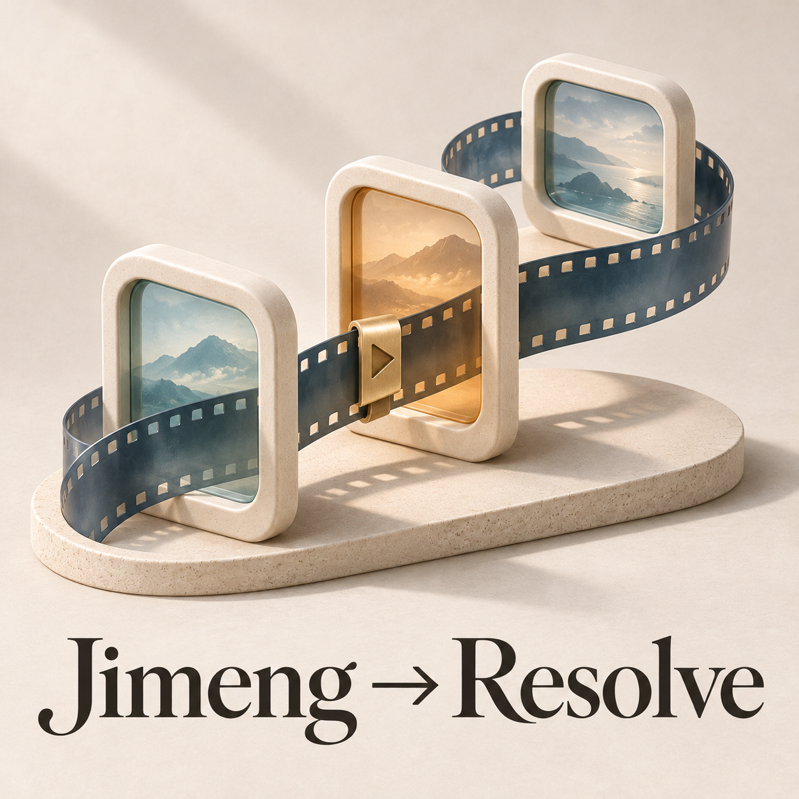

# Jimeng → DaVinci Resolve

## Resumable Production Skill for Codex

**Keep every shot connected—from the first idea to the editing timeline.**

**Developed by Hainan Yuandou Technology Co. Ltd.**

Jimeng → DaVinci Resolve is a reusable Codex skill that organizes an AI video project across planning, image preparation, video generation, media processing, and post-production. It brings prompts, narration, reference images, selected clips, and editing plans into a consistent project structure, so creators can pause, return, and continue with the work already in place.

Designed for independent creators, small production teams, and editors working with AI-generated footage, the skill helps reduce the friction between creative tools. Stable shot IDs connect each idea to its media. An editable project manifest records the chosen versions and shot order. Original clips and earlier handoff packages remain available as the project develops.

### Core capabilities

- **Continuity across sessions.** Store project requirements, narration, prompts, and selected media paths in a shared manifest that Codex or a person can update when work resumes.
- **Shot-level organization.** Keep image references, generated clips, and processed versions linked to the same shot ID, making targeted revisions easier to manage.
- **Editing-ready media preparation.** Inspect downloaded footage and convert selected clips into landscape or portrait 4K ProRes media, with options for framing, frame-rate treatment, and encoding quality.
- **Transparent processing records.** Save the conversion method and technical validation results alongside each output. Preserve source footage and use new filenames for revised outputs.
- **Versioned editorial handoffs.** Generate an ordered editing table, narration text, media paths, and import instructions in a new handoff directory, with missing or unprocessed shots identified.

### The five-step workflow

1. **Plan with Codex.** Develop narration, a shot list, reference images, image and video prompts, and draft publishing copy around the creative brief.
2. **Generate in Jimeng.** Create clips from the selected references, review their content and continuity, and archive the chosen downloads.
3. **Prepare locally.** Inspect the footage, process a representative clip, review the result, and convert the selected batch into suitable editing media.
4. **Hand off the project.** Update the manifest and produce a versioned package that communicates shot order, planned timing, narration, and media locations.
5. **Finish in DaVinci Resolve.** Assemble the timeline, refine pacing, grade, add voiceover and subtitles, mix audio, and export the finished video.

### Current scope

The current release includes workflow guidance and Python tools for project initialization, media inspection, conversion, and handoff generation. Jimeng API integration, an AI super-resolution engine, and automatic Resolve import are not built in. Ordinary 4K scaling does not recover native source detail. A handoff marked `ready` confirms processed-file availability only; visual quality and timeline results still require review. A complete real-project pipeline through final Resolve export has not yet been validated end to end.
